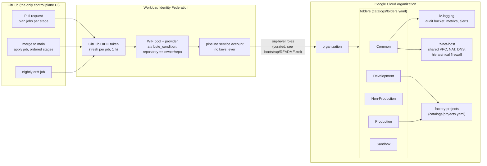
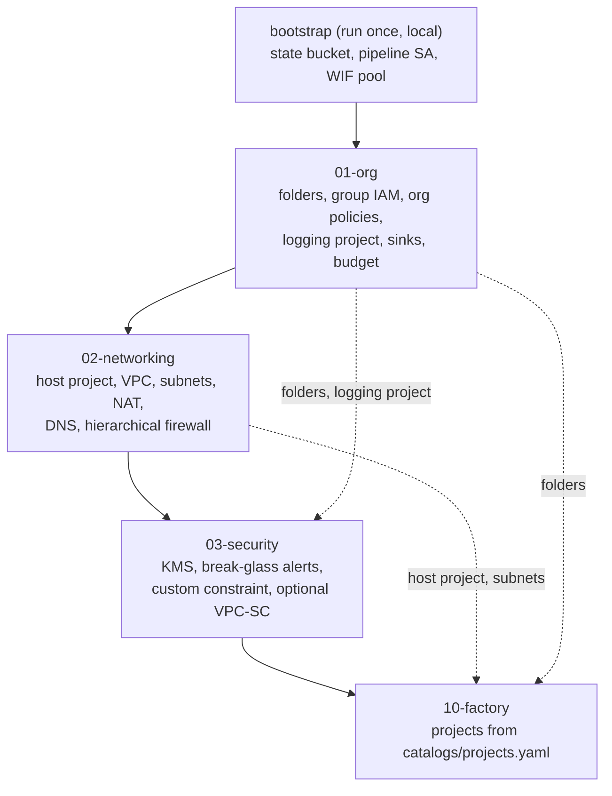

# Architecture

## The big picture

## Stages and data flow

Each stage is an independent Terraform root module with its own state file,
applied in dependency order. Later stages read earlier stages' outputs via
`terraform_remote_state` from the central bucket — never by hardcoding ids.

## Catalogs: the source of truth

Everything a platform team changes day to day lives in five YAML files, not
in Terraform:

| Catalog | Drives | Stage |
| --- | --- | --- |
| `folders.yaml` | folder taxonomy | 01-org |
| `groups.yaml` | group inventory + IAM bindings | 01-org, 02, 10 |
| `org-policies.yaml` | org policy library + folder exceptions | 01-org |
| `networks.yaml` | VPC, subnets, secondary ranges, NAT, DNS | 02-networking |
| `projects.yaml` | project factory: every workload project | 10-factory |

`scripts/validate_catalogs.py` checks the catalogs (uniqueness,
cross-references, CIDR overlaps, GCP name-length limits) in CI before any
Terraform runs, so a broken YAML never reaches a plan.

## Security model

- **No service account keys exist.** The org policy library disables SA key
  creation org-wide from the first apply. The pipeline authenticates via
  GitHub-issued OIDC tokens, which expire within an hour.
- **Federation is repository-scoped.** The WIF provider's attribute
  condition only accepts tokens for this repository; anything else is
  rejected before it can become credentials.
- **Humans get groups, not roles.** IAM grants bind to the groups in
  `groups.yaml` — never to individual users.
- **Break-glass is monitored, not prevented.** Organization IAM changes,
  org policy changes, and SA key creation trigger an alert to the
  security-admins group within a minute (stage 03-security).
- **Every apply is reviewable.** PRs produce per-stage plans; merge applies
  through the `landing-zone` environment, which you can protect with
  required reviewers. A nightly drift job catches out-of-band changes.

## What is intentionally out of scope

- **Workload infrastructure.** GKE clusters, Cloud SQL, buckets — they
  belong in the app projects created by the factory, managed by app teams.
- **Hybrid connectivity.** No Interconnect/VPN; `networks.yaml` keeps
  `internal_source_ranges` so the firewall policy is ready for it.
- **Compliance-specific posture.** CIS/HIPAA/SOC2 mappings are a natural
  fork of `org-policies.yaml`, but not shipped here.
- **Multi-region.** One region (`europe-west1`) in the example catalog —
  add more subnets and NAT routers as needed.
