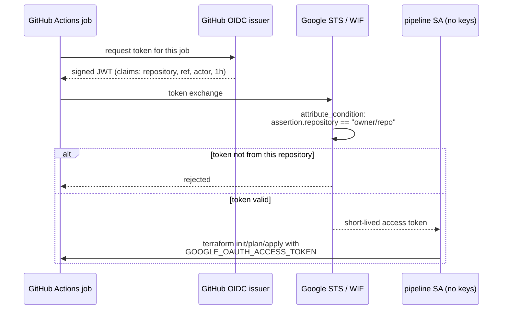

# The pipeline: GitHub-native, zero stored credentials

## Why there are no secrets

Most landing zone templates (including Google's own) store a service
account **key** in the CI system. That key is a permanent, copyable
credential: whoever holds it *is* the pipeline, from anywhere, forever.

This repository uses **Workload Identity Federation** instead. GitHub signs
a short-lived OIDC token for every job; Google exchanges it (through the WIF
provider created by bootstrap) for at most one hour of pipeline access.
Nothing secret is ever stored — the five repository variables are all
non-credentials:

| Variable | What it is | Secret? |
| --- | --- | --- |
| `GCP_WIF_PROVIDER` | WIF provider resource name | no — an identifier, not a credential |
| `GCP_STATE_BUCKET` | state bucket name | no |
| `GCP_ORG_ID` | organization number | no |
| `GCP_BILLING_ACCOUNT` | billing account id | no — for wider visibility, move it into a protected environment |
| `LZ_PREFIX` | resource name prefix | no |

## The flow



A stolen token is useless after the job ends, and cannot even be minted for
another repository because of the provider's attribute condition.

## Job structure

| Workflow | Trigger | What it does |
| --- | --- | --- |
| `ci.yml` | every PR / push | fmt check, `terraform validate` for all stages, tflint, catalog validation, checkov (soft-fail) — **no GCP access needed** |
| `deploy.yml` plan | PR | OIDC-authenticated `terraform plan -detailed-exitcode` per stage (parallel matrix); summary written to the PR |
| `deploy.yml` gate | push to main | fail-closed check that the `landing-zone` environment has required reviewers — fails the run before any apply if not |
| `deploy.yml` apply | push to main | waits for a reviewer approval on the `landing-zone` environment, then applies stages **in order**: 01-org → 02-networking → 03-security → 10-factory |
| `drift.yml` | nightly 03:00 UTC | plan of every stage; opens or comments on a `drift`-labeled issue if any stage reports changes |

## Guardrails to enable on GitHub

1. **Environment protection** for `landing-zone`: required reviewers —
   this is what turns every apply into a two-human action. It is managed
   by Terraform in [bootstrap/tf-gate](../bootstrap/tf-gate): run it via
   `bootstrap.sh --github-token ... --reviewer-users ...` (see the
   [README](../README.md#quickstart)), or directly:

   ```bash
   cd bootstrap/tf-gate
   export TF_VAR_github_token=ghp_...   # repo-admin PAT, one-off
   terraform init -backend-config=bucket=$LZ_STATE_BUCKET \
     -backend-config=prefix=landing-zone/github-gate
   terraform apply \
     -var github_owner=my-org -var github_repo=gcp-landing-zone \
     -var 'reviewer_users=["alice","bob"]'
   ```

   It sets required reviewers, `prevent_self_review = true` (whoever
   pushed cannot approve the apply) and `can_admins_bypass = false`.
   Without it, the deploy workflow's gate job fails every apply — the
   protection cannot be forgotten silently.
2. **Branch protection** on `main`: require the `ci` and `deploy` (plan)
   checks, require PR reviews. The environment gate alone cannot stop a
   direct push that edits the workflows themselves.
3. Keep `CODEOWNERS` pointed at the platform team so catalog changes get
   routed for review.

## Running stages locally

The pipeline is the intended path, but local runs work with Application
Default Credentials (`gcloud auth application-default login`):

```bash
export LZ_ORG_ID=... LZ_BILLING_ACCOUNT=... LZ_PREFIX=lz LZ_STATE_BUCKET=...
make plan  STAGE=01-org
make apply STAGE=10-factory
```

Terraform state is the same bucket and prefix the pipeline uses, so local
applies and pipeline applies are interchangeable.
